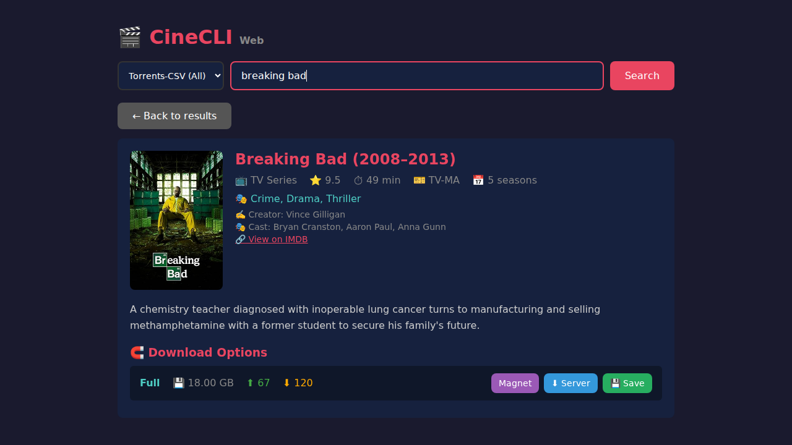

# 🎬 C-CLI - Movie & TV Show Browser

A Go application for browsing and downloading movies and TV shows. Available as both a **terminal UI (TUI)** and a **web app**.

Inspired by [cinecli](https://github.com/eyeblech/cinecli) by [@eyeblech](https://github.com/eyeblech).

## ✨ Features

- 🔍 **Multiple search sources:**
  - **YTS** - High quality movie torrents
  - **Torrents-CSV** - General torrents (movies, TV shows, and more)
- 🎬📺 View detailed movie & TV show information (enriched with IMDB data via OMDB)
- 📺 **TV Show Support** - Automatic detection of TV series with season counts, episode runtimes, creators
- 📊 Search results sorted by IMDB popularity
- 📄 **Pagination** - Navigate through large result sets
- 🧲 Generate magnet links
- 📦 Download `.torrent` files
- ⚡ Auto-select best torrent (highest quality + healthy seeds)
- 🖥 Cross-platform (Linux, macOS, Windows, FreeBSD)

---

## 💻 TUI Version

Terminal-based interface built with [Bubble Tea](https://github.com/charmbracelet/bubbletea).

### Build & Run

```bash
go build -trimpath -o c-cli .

# With OMDB API key (recommended - enables ratings, cast, plot, sorted by popularity)
OMDB_API_KEY=your_key ./c-cli

# Without OMDB (basic mode)
./c-cli
```

### Screenshot

```
🎬 CineCLI - Movie Browser

🔍 Search for movies:

> inception
```

### Keyboard Controls

| Key | Action |
|-----|--------|
| `↑`/`↓` or `j`/`k` | Navigate lists |
| `←`/`→` or `[`/`]` | Previous/Next page (search results) |
| `Enter` | Select / Show magnet link |
| `0-9` | Select torrent by index |
| `Tab` | Switch source (search) / Switch sections |
| `Esc` | Go back |
| `a` | Auto-select best torrent |
| `m` | Show magnet link |
| `t` | Download `.torrent` file |
| `Ctrl+C` | Quit |

### Configuration

Create `~/.config/c-cli/config.toml`:

```toml
search_limit = 50
download_dir = "~/Downloads"
omdb_api_key = "your_key_here"  # Optional, or use OMDB_API_KEY env var
search_source = "yts"           # "yts" or "torrents-csv"
```

With OMDB enabled:
- Search results sorted by IMDB popularity (vote count)
- Full movie/TV show details: rating, runtime, director/creator, cast, plot
- TV shows display season count and episode runtime
- IMDB ratings instead of YTS ratings

Search sources:
- **yts** - High quality movie torrents (default)
- **torrents-csv** - General torrents including TV shows

---

## 🌐 Web Version

Web-based interface with OMDB/IMDB integration for rich movie and TV show metadata.



### Build & Run

```bash
cd c-cli-web
go build -trimpath -o c-cli-web .

# With OMDB API key (recommended - enables posters, ratings, cast, plot)
OMDB_API_KEY=your_key ./c-cli-web

# Without OMDB (basic mode)
./c-cli-web
```

Then open http://localhost:8000

### Features

- 🔍 **Multiple search sources:** YTS (movies) or Torrents-CSV (all)
- 🎬📺 Movie and TV show posters in search results and details
- 📺 **TV Show Support:**
  - Automatic detection of TV series vs movies
  - Season count display
  - Episode runtime
  - Creator information (instead of director)
  - Series type badges in search results
- ⭐ IMDB ratings, runtime, genres, director/creator, cast
- 📊 Results sorted by IMDB popularity
- 📝 Full plot descriptions
- 🧲 Magnet links with copy to clipboard
- ⬇ Download `.torrent` to server
- 💾 Download `.torrent` to your browser
- 🧲 **Torrent Cache Integration** - Fetches .torrent files from cache services for Torrents-CSV
- 🔗 Click poster to open IMDB page
- 🌙 Dark theme UI

### Environment Variables

| Variable | Default | Description |
|----------|---------|-------------|
| `PORT` | `8000` | Server port |
| `HOST` | `127.0.0.1` | Bind address |
| `DOWNLOAD_DIR` | `$HOME` | Server download directory |
| `OMDB_API_KEY` | _(none)_ | [Get free key](https://www.omdbapi.com/apikey.aspx) |

See [c-cli-web/README.md](./c-cli-web/README.md) for full documentation.

---

## 🛠 Tech Stack

- **Go** - Programming language
- **Bubble Tea** - TUI framework
- **Lip Gloss** - TUI styling  
- **YTS API** - Movie/torrent data
- **Torrents-CSV API** - General torrent search
- **OMDB API** - IMDB metadata (optional, both versions)

## 📄 License

Apache License 2.0 - see [LICENSE](./LICENSE) and [NOTICE](./NOTICE) for details.
