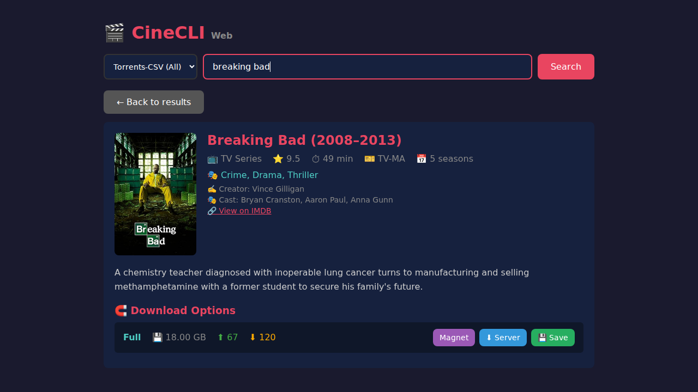

# 🎬 CineCLI Web

A web interface for browsing and downloading movies and TV shows, with TMDB or OMDb metadata.



## ✨ Features

- 🔍 **Multiple search sources:**
  - **YTS** - High quality movie torrents
  - **Torrents-CSV** - General torrents (movies, TV shows, and more)
- 🎬📺 View movie & TV show details with posters, ratings, cast, and plot (via TMDB or OMDb)
- 📺 **TV Show Support:**
  - Automatic detection of TV series vs movies
  - Season count and episode runtime display
  - Creator information for series
  - Type badges (📺 Series) in search results
- 📊 Search results sorted by popularity
- 📄 **Pagination** - Navigate through unlimited results with page controls
- 🧲 Generate magnet links (with copy to clipboard)
- ⬇ Download `.torrent` files to server
- 💾 Download `.torrent` files to your browser/computer
- 🧲 **Torrent Cache Integration** - Fetches actual .torrent files from cache services (itorrents.org, btcache.me) for Torrents-CSV results
- 🎬 Click poster to open IMDB page

## 🚀 Usage

```bash
# Build
go build -trimpath -o c-cli-web .

# Run with a free TMDB key (recommended), see "Getting a free TMDB key" below
TMDB_API_KEY=your_key ./c-cli-web

# Or with an OMDb key
OMDB_API_KEY=your_key ./c-cli-web

# Run without either (basic mode)
./c-cli-web
```

Then open http://localhost:8000

## ⚙️ Configuration

All configuration is via environment variables:

| Variable | Default | Description |
|----------|---------|-------------|
| `PORT` | `8000` | Server port |
| `HOST` | `127.0.0.1` | Bind address (use `0.0.0.0` for all interfaces) |
| `DOWNLOAD_DIR` | `$HOME` | Directory for server-side torrent downloads |
| `TMDB_API_KEY` | _(none)_ | TMDB API Key or API Read Access Token (`TMDB_TOKEN` also works). See below |
| `OMDB_API_KEY` | _(none)_ | Or an OMDb key ([get one free](https://www.omdbapi.com/apikey.aspx), 1,000 requests a day) |
| `METADATA_SOURCE` | _(auto)_ | TMDB is used when its key is set; `omdb` prefers OMDb when both are set |

With TMDB or OMDb enabled:
- Search results sorted by popularity (vote count; TMDB's or IMDb's)
- Full movie details: rating, runtime, director, cast, plot
- Full TV show details: rating, seasons, episode runtime, creator, cast, plot
- Type detection (movie vs series vs episode)
- Smart title matching (strips year/codec info for better matches)

### Example

```bash
PORT=3000 DOWNLOAD_DIR=/data/torrents TMDB_API_KEY=abc123 ./c-cli-web
```

### Getting a free TMDB key

1. Create an account at [themoviedb.org/signup](https://www.themoviedb.org/signup) and confirm your email.
2. Open [Settings → API](https://www.themoviedb.org/settings/api) and request an API key: choose *Developer*, accept the
   terms, and fill in the short form (personal, non-commercial use is fine).
3. Copy either the **API Key** (32 characters) or the **API Read Access Token** (starts with `eyJ`). Either works.

Running it on a [watchbox](https://github.com/jgbrwn/watchbox) download box? Use the same Read Access Token as your
watchbox Worker: one free key covers both.

### Library notes (optional)

If something in front of c-cli-web (a reverse proxy) adds `library_note` and `library_state` (`have` or
`downloading`) to the JSON of `/api/search`, `/api/movie/<id>` or `/api/omdb`, the page shows the note as a badge on
the result and a banner on its details, and asks "Download anyway?" before saving a torrent.
[watchbox](https://github.com/jgbrwn/watchbox) uses this to mark titles already in your library or already downloading.
Without such a proxy nothing changes.

## 📡 API Endpoints

| Endpoint | Description |
|----------|-------------|
| `GET /` | Web UI |
| `GET /api/search?q=<query>&source=<yts\|torrents-csv>&page=<n>&per_page=<n>` | Search with pagination (default: page=1, per_page=20) |
| `GET /api/movie/<id>` | Get movie details (with TMDB/OMDb data if configured) |
| `GET /api/omdb?i=<imdb_id>` or `?t=<title>&y=<year>` | Look up metadata directly (OMDb-shaped JSON, from TMDB or OMDb) |
| `GET /api/magnet?hash=<hash>&name=<name>` | Generate magnet link |
| `GET /api/download?url=<url>&title=<title>&quality=<quality>` | Download .torrent to server |
| `GET /api/download-file?url=<url>&title=<title>&quality=<quality>` | Download .torrent to browser |
| `GET /api/save-magnet?infohash=<hash>&title=<title>` | Save .torrent to server (tries cache services, falls back to .magnet) |
| `GET /api/download-torrent?infohash=<hash>&title=<title>` | Download .torrent to browser (tries cache services, falls back to .magnet) |

## 🛠 Tech Stack

- **Go** - No external web frameworks (stdlib only)
- **Embedded static files** - Single binary deployment
- **YTS API** - Movie and torrent data
- **Torrents-CSV API** - General torrent search
- **TMDB API** or **OMDb API** - metadata (optional)

<sub>This product uses the TMDB API but is not endorsed or certified by TMDB.</sub>

## 📄 License

Apache License 2.0 - see [LICENSE](../LICENSE) and [NOTICE](../NOTICE) for details.
